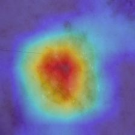
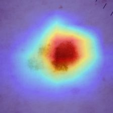

# DermaLens

DermaLens is an educational image-classification research project using the
HAM10000 dermatoscopic image dataset. It is not a diagnostic product.

## Grad-CAM examples

These compact overlays come from the validation split and illustrate the
frozen Stage B model's Grad-CAM for its selected class. The source images were
resized to 224×224 and the heatmaps were added by this project.



Correct melanoma prediction (HAM10000 image `ISIC_0024537`).



Missed melanoma prediction (HAM10000 image `ISIC_0024313`); the frozen
validation-threshold decision was `nv`.

Grad-CAM shows model attention, not medical correctness. These are educational
visualizations and are not clinical evidence.

Image source attribution: Tschandl, P., Rosendahl, C., and Kittler, H. “The
HAM10000 dataset, a large collection of multi-source dermatoscopic images of
common pigmented skin lesions.” *Scientific Data* 5, 180161 (2018).
[Data paper](https://doi.org/10.1038/sdata.2018.161) ·
[Harvard Dataverse dataset](https://doi.org/10.7910/DVN/DBW86T).

## Application Images


## Local API

Configure `stage_b_checkpoint` in the ignored `dataset_config.json` (or leave
it unset to use `checkpoint_root/stage_b/best.pt`), then run:

```powershell
uvicorn src.api:app --host 127.0.0.1 --port 8000
```

The FastAPI routes, upload limits, response fields, CORS origins, and tests are
documented in [API.md](API.md). The API uses argmax predictions and returns an
educational disclaimer with every response.

Start the frontend in a second PowerShell window:

```powershell
cd frontend
npm ci
npm run dev
```

Vite serves the page at `http://127.0.0.1:5173` and proxies `/api` requests to
the local FastAPI server on port 8000.
